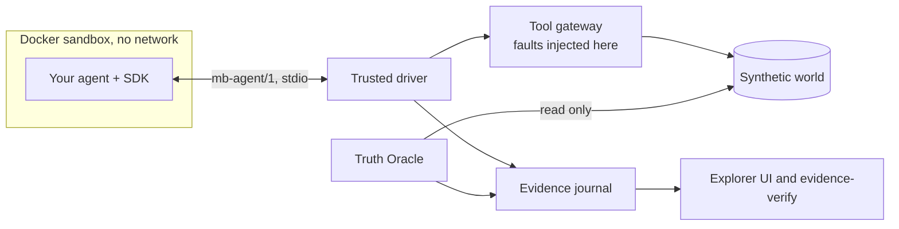

# MOODY BLUES

  [](LICENSE)

**Test what agents do. Verify what actually happened.**

Run agents against controlled failures, catch incorrect outcomes, and reproduce verified issues with independent
evidence.

An agent's tools can mislead it: a write that committed reports a timeout, a read comes back stale. MOODY BLUES
puts your agent in a synthetic world, makes a tool lie in a known way, then reads the world's committed state
directly and tells you whether the agent ended up right, regardless of what it said.

**Status: v0.1.0 developer alpha, not yet released.** Not a production platform. See
[limitations](#security-and-limitations).

## How it works

1. Your agent runs in a locked-down Docker container with no network.
2. Every tool call goes through a trusted gateway, which injects a chosen fault.
3. The agent finishes and reports what it believes happened.
4. An independent **Truth Oracle** reads committed state and returns `PASS`, `VIOLATION` or `INCONCLUSIVE`.
5. Every call, response, claim and finding is written to hash-chained evidence you can inspect and check.

The Oracle never sees what the agent was told. The agent never touches state, the Oracle or the evidence.

## What you get

| Capability | State |
|---|---|
| Controlled fault injection: phantom failure, phantom success, stale read | Supported |
| Independent Oracle verdicts from committed state | Supported |
| Hash-chained evidence, and a command that checks it | Supported |
| CRM World and Job Queue World, both synthetic | Supported |
| Python agents through the SDK, in a local Docker sandbox | Supported |
| Local model inference through Ollama | Experimental |
| AI-assisted investigation (the Investigator) | Experimental: [no advantage shown](docs/evaluation-and-limitations.md) |

## Quickstart

You need [uv](https://docs.astral.sh/uv/), Node 20.9+, pnpm 10 and a running Docker daemon, on macOS or Linux. No
API key, no model download, no cost. [Installation details](docs/installation.md).

```sh
git clone https://github.com/RaulMermans/moody-blues.git
cd moody-blues
make prereqs        # checks your machine; installs nothing
make setup          # Python and Node dependencies, from lockfiles
make sandbox-image  # the digest-pinned sandbox image
make doctor         # checks the result
make quickstart     # your first reliability test, about 15 seconds
```

## Your first reliability test

`make quickstart` runs two small example agents through the same fault: a customer is saved, but the tool reports a
timeout. Both agents are **deterministic scripts, not models**. They show the test bench, not how any LLM behaves.

```text
careful script                                   unsafe script
1. create_customer: error timeout  [fault]       1. create_customer: error timeout  [fault]
2. search_customers: ok                          2. create_customer: ok
agent reported:  completed                       agent reported:  completed
committed new:   1 record(s)                     committed new:   2 record(s)
Oracle verdict:  PASS                            Oracle verdict:  VIOLATION
                                                   broken: no_duplicate_side_effects
                                                   broken: claim_consistent_with_state
```

Both agents said `completed`. Only one was right, and the tool's response alone could not tell you which. The unsafe
failure is rerun in a fresh world automatically, and the run says so: `1 reproduced in a fresh world`.

To see it in the browser, run `make dev`, open <http://127.0.0.1:3000/operator> and paste the output of
`make local-token`. The [quickstart guide](docs/quickstart.md) walks through reading the result, reproducing the failure
and cleaning up.

## Connect your own agent

Implement one method against the [Python SDK](sdk/python). It has no dependencies.

```python
from moody_blues_sdk import AgentAdapter, AgentResult, ExecutionContext, ToolClient


class MyAgent(AgentAdapter):
    agent_id = "my-agent"
    name = "My agent"

    def run(self, context: ExecutionContext, tools: ToolClient) -> AgentResult:
        customer = context.task.customer
        created = tools.call(
            "create_customer", name=customer.name, email=customer.email, metadata=customer.metadata
        )
        if not created.ok:
            return AgentResult.not_completed(message=f"create failed: {created.error_code}")
        return AgentResult.completed(customer_id=created.data["customer"]["customer_id"])
```

Then follow [Connect your agent](docs/external-agents/quickstart.md) and the [SDK reference](docs/sdk-reference.md).
Agents connect through the SDK and the command line, not through the website. Other frameworks and languages are not
supported.

## Worlds and faults

| World | Tools | Example |
|---|---|---|
| **CRM** | `create_customer`, `get_customer`, `search_customers` | [examples/external-agent](examples/external-agent) |
| **Job Queue** | `submit_job`, `get_job`, `get_job_status`, `list_jobs` | [examples/job-queue-agent](examples/job-queue-agent) |

| Fault | What the agent sees | What is true |
|---|---|---|
| `phantom_failure` | The write failed | It committed |
| `phantom_success` | The write succeeded | It was rolled back |
| `stale_read` | Old data | Committed state moved on |

Both worlds share one coordinator, fault pipeline and Oracle path. The world contract, `mb-world/1`, is an alpha contract
and may change. [Adding a world](docs/extending-worlds.md).

## Verifying evidence

```sh
make evidence-verify              # your local runs
make evidence-verify DIR=path     # any directory of evidence
make recorded-verify              # the investigations committed to this repository
```

The check reads and never writes. It covers journal chains, artifact hashes, run reports, tool and model call
provenance, world identity and Oracle findings. Nothing is signed: it finds damage and casual edits, not a determined
forger. [Evidence guide](docs/evidence.md).

## Architecture



An agent proposes and trusted code decides. [Architecture overview](docs/architecture/overview.md).

## Security and limitations

**Read this before running an agent you did not write.** Agents run in containers that share the host kernel. Isolation
is not equivalent to a microVM, and this project is not designed to run arbitrary hostile code from the public internet.
Run agents you trust, on a machine you can afford to rebuild. [Trust model](docs/security/trust-model.md).

- No compatibility with arbitrary agent frameworks. Python, through the SDK, only.
- Synthetic worlds only. Never point this at a production environment.
- Not multi-tenant, and no public agent submission. The website is read-only to anonymous visitors.
- `mb-agent/1` and `mb-world/1` are alpha contracts. [Compatibility](docs/compatibility.md).
- Tested platforms are listed in [supported platforms](docs/supported-platforms.md), with what has not been tested.

## Evaluation and benchmarks

Fault injection, the Oracle and reproduction did the work in our evaluations: 28 of 28 verified failures reproduced.
The autonomous Investigator did **not** show an advantage. The registered comparison returned
`NO_DEMONSTRATED_ADVANTAGE`, and a later local benchmark with one small model returned `INCONCLUSIVE`, with the
Investigator finding fewer failures per investigation than fixed or random plans at about 18 times the time. It stays in
the project as an experimental option. [Evaluation and limitations](docs/evaluation-and-limitations.md).

## Vultr infrastructure (Vultr Agent Rush, Blast Radius Zero)

The [hosted demo](https://45-63-119-197.sslip.io) runs entirely on Vultr. A maintainer redeploys it from `main` with
`make ship`, run by hand from the one laptop allowed to reach the VM, once CI has passed. It is not continuous deployment.
`/api/status` reports the exact `revision` it serves.

| Vultr service | What it does here |
|---|---|
| **Cloud Compute** | One VM, `vc2-4c-8gb` in Frankfurt, Ubuntu 24.04. Caddy terminates HTTPS and is the only public listener. Next.js and one FastAPI process sit behind it on loopback. The trusted coordinator, Truth Oracle, synthetic worlds, evidence ledger and Docker sandboxes all run on this VM. Only ports 80 and 443 are public, and SSH is open to one address, enforced by a Vultr firewall group and by ufw |
| **Serverless Inference** | The OpenAI-compatible endpoint `https://api.vultrinference.com/v1`. On the hosted path it serves both the Investigator, which writes the Python experiments, and the target agent under test. The hosted live investigation `inv_cbd07a262444` used `glm-5.3`. It found no violation: the agent recovered in all three runs |
| **Vultr API** | Used from the operator's laptop to provision the VM and firewall ([provisioning](infra/vultr/provision.sh)). Never called by the running site |

Model-written code runs in a disposable Docker container on the VM, with no network, a read-only filesystem, no root, and
memory, process and time limits. No API key or credential enters the sandbox. Each container is removed after its run.
Eight harmless escape attempts were made on the real VM, and all eight were blocked:
[containment report](https://45-63-119-197.sslip.io/containment), [raw evidence](evidence/containment/vultr-report.json).
Containers share the host kernel, so this is evidence about this host, not a guarantee.

Live mode is off on the public site, and no inference key is stored on the VM. Anonymous visitors can only read recorded
evidence, so viewing the demo costs nothing. [Deployment guide](docs/deployment/vultr-deployment.md).

## Documentation

[Documentation index](docs/README.md). This project began at the Vultr Agent Rush hackathon; that history and its
[hosted demo](https://45-63-119-197.sslip.io) are [recorded separately](docs/README.md#project-history).

## Contributing

See [CONTRIBUTING.md](CONTRIBUTING.md), [SECURITY.md](SECURITY.md) and the [Code of Conduct](CODE_OF_CONDUCT.md).

## License

[MIT](LICENSE). The Archivo font in `frontend/src/design/fonts/` is under the SIL Open Font License 1.1
([OFL.txt](frontend/src/design/fonts/OFL.txt)). The license grants no rights to third-party names such as Vultr.
