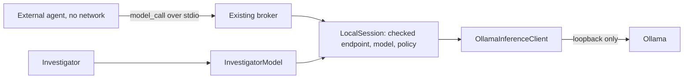

# ADR 0014: Local inference through Ollama

**Status:** accepted, Sprint 17. Extends [ADR 0012](0012-external-agent-adapter.md) and
[ADR 0013](0013-investigating-external-targets.md).

## Context

Every model an external agent or the Investigator had met was a labeled fixture. A real hosted run needs a raised
ledger limit and paid approval. The broker already takes any `InferencePort`, but `_open_live` is Vultr only, and
`EvidenceSource` could only say `live_provider` or `offline_fixture`.

## Decision

Ollama is a first-class provider behind `InferencePort`.

1. **Its own identity.** New evidence value `local_ollama`, new `ExecutionMode.LOCAL`, provider `ollama`.
   `MOODY_VULTR_BASE_URL` is never pointed at it: that would write false provenance. `MODEL_EVIDENCE` names what is
   evidence of model behavior, so `live_provider` keeps its meaning of hosted and paid.
2. **The native API, not the OpenAI-compatible one.** `/api/chat` takes `num_ctx`. Without it a long prompt is cut with
   no error. It also reports the timings, and `/api/show` and `/api/tags` give the digest and capabilities.
3. **One narrow translation.** `to_ollama_messages` turns argument strings into objects and adds `tool_name`. The
   protocol, SDK, broker and workflow are unchanged. There is no second pipeline.
4. **Loopback only.** The address must be literal `127.0.0.1` or `[::1]`, plain HTTP, no path, query or credentials.
   Names are refused because they can resolve anywhere. Redirects are not followed and proxy settings are ignored.
5. **Its own limits, no ledger.** `LOCAL_POLICY` bounds calls, tokens, prompt size, time, concurrency and experiments,
   and is recorded with every run. A local run never reserves or settles against the ledger.
6. **Stops really stop.** Answers stream, so the deadline covers the whole answer. `InferenceBroker.abort` closes
   the connection when the host gives up, which ends the generation instead of leaving the machine busy.
7. **Local and paid never mix** in one run. The command refuses it.

## Structured output

Provider-native structured output is not used. Ollama's `format` constrains the whole reply, so a model could not also
call a tool, and an agent's turn may be either. No framing is normalized in the host: an agent's final message is
the agent's business, and KITE's strict parser is left as it is. Malformed output stays a recorded outcome. In Sprint 17
none occurred with the selected model.

## `tool_choice`

Ollama has none. `"required"` is sent as tools on offer, so a model may answer in text. `parse_decision` already
rejects that as `invalid_decision`, so nothing is weakened. `"none"` sends no tools.

## Evidence compatibility

Literals are widened and new fields are optional and left out when absent, so earlier records stay byte-identical and
nothing is reclassified. The schema version does not change. `make recorded-verify` holds this.

## Consequences

- A run's `reported_models` is the provider's word, and the digest comes from the server at open. A tag could be
  repointed between runs, which is why the digest is what is recorded.
- Local evidence is operator evidence. Curated recorded cases still require `live_provider`, so a local run cannot be
  exported as one.
- Registered evaluation still reads `live_provider` only. A local run cannot enter a registered result.

## Not decided here

A local model on the hosted VM, several loaded models, GPU scheduling, and any comparison between models.
