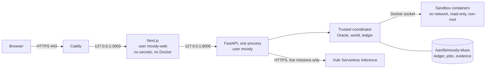

# Deploying to Vultr

How to run MOODY BLUES on one Vultr VM. Everything that costs money or changes something external is
marked **[approval]**. The reviewed plan is in [sprint-8-provisioning-plan.md](sprint-8-provisioning-plan.md).

## Architecture



Public ports are 80 and 443. Port 22 is open to one address. Everything else is closed twice: by the Vultr
firewall group and by ufw.

## Files

| File | Runs | Purpose |
|---|---|---|
| `infra/vultr/plan.env` | | The reviewed plan and region |
| `infra/vultr/provision.sh` | laptop | `plan`, `apply`, `status`, `destroy` |
| `infra/vultr/bootstrap.sh` | VM, once | Packages, users, Docker, firewall, SSH, pinned image |
| `infra/vultr/deploy.sh` | laptop | Ships the committed HEAD and builds it |
| `infra/vultr/remote-switch.sh` | VM | Switches release, proves it serves, goes back on failure |
| `infra/vultr/rollback.sh` | laptop | Returns to the previous release |
| `infra/vultr/migrate-ledger.sh` | laptop | Moves the ledger once and proves it arrived unchanged |
| `infra/vultr/live-switch.sh` | laptop | The owner's switch for chargeable missions |
| `infra/vultr/live-env.py` | VM, sent by the switch | Rewrites `backend.env` atomically; the key arrives on stdin |
| `infra/vultr/moody-cli` | VM | Runs a command as the service does |

## Steps

`IP` is the VM address. `HOST` is the public name. With no domain, `<ip-with-dashes>.sslip.io` resolves to the
VM with no DNS change, and Caddy can get a real certificate for it.

```bash
# 1. Read the plan at current prices. Free; no key.
make vultr-plan

# 2. [approval, starts billing] VULTR_API_KEY is the account key, not the inference key.
export VULTR_API_KEY=...
infra/vultr/provision.sh apply --confirm vc2-4c-8gb@fra \
  --admin-cidr "$(curl -s https://api.ipify.org)/32" --ssh-key ~/.ssh/id_ed25519.pub
infra/vultr/provision.sh status

# 3. [approval] Bootstrap the host.
git archive HEAD infra/vultr | ssh root@$IP 'mkdir -p /root/mb && tar -x -C /root/mb'
ssh root@$IP "ADMIN_CIDR=<your-ip>/32 bash /root/mb/infra/vultr/bootstrap.sh"

# 4. [approval] Deploy. Spending stays off, and no provider key is on the VM yet.
infra/vultr/deploy.sh $IP $HOST

# 5. Move the ledger. From here the VM's copy is canonical: stop making live calls from the laptop.
infra/vultr/migrate-ledger.sh $IP

# 6. Collect containment evidence on the real host, and check it.
ssh root@$IP moody-cli containment-report
ssh root@$IP moody-cli investigator-preflight

# 7. Test the public site. The token stays in your shell.
export MOODY_HOSTED_OPERATOR_TOKEN="$(ssh root@$IP sed -n 's/^MOODY_OPERATOR_TOKEN=//p' /etc/moody-blues/backend.env)"
MOODY_HOSTED_URL=https://$HOST MOODY_HOSTED_TARGET=vultr make test-hosted

# 8. [approval, chargeable] One live investigation, then off again.
infra/vultr/live-switch.sh $IP on 7.30
MOODY_HOSTED_LIVE=1 MOODY_HOSTED_URL=https://$HOST MOODY_HOSTED_TARGET=vultr \
  pnpm --dir frontend exec playwright test --config playwright.hosted.config.ts -g "one authorized"
infra/vultr/live-switch.sh $IP off
```

`MOODY_HOSTED_TARGET=local-tls-proxy` exists for rehearsing the suite through a local Caddy. Its results are
never hosted evidence, and the Containment page says `LOCAL DEVELOPMENT, NOT HOSTED` until a report from the
real VM exists: only a reply from the instance metadata service can mark a report as hosted.

## Operating it

```bash
ssh root@$IP systemctl status moody-backend moody-web caddy
ssh root@$IP journalctl -u moody-health* -n 5       # health and disk, every five minutes
ssh root@$IP journalctl -u moody-backend -n 50
ssh root@$IP moody-cli live-budget
ssh root@$IP "docker ps -a --filter label=io.moody-blues.sandbox"
```

- **Restart:** `systemctl restart moody-backend`. A job that was running is reconciled, never replayed.
- **Upgrades:** a redeploy refuses while a job runs, because a restart would make it `outcome_uncertain`.
- **Logs:** journald keeps 1 GB or 14 days. Sandboxes keep no logs.
- **Evidence:** nothing is deleted automatically, and the health check fails at 80% disk. A person decides what
  goes. Never delete `live-spend/`.

## Rollback

```bash
infra/vultr/rollback.sh $IP            # the previous release
infra/vultr/rollback.sh $IP <sha>      # a named one still on the VM
```

The ledger and evidence are unaffected. A failed deploy already rolls itself back.

## Destroying everything

Stopping a VM does not stop its billing. Only destruction does.

```bash
# Keep the record first.
scp root@$IP:/var/lib/moody-blues/artifacts/live-spend/ledger.jsonl .artifacts/live-spend/ledger.jsonl
scp root@$IP:/var/lib/moody-blues/artifacts/containment/report.json evidence/containment/report.json
make ledger-verify

infra/vultr/provision.sh destroy --confirm "$(python3 -c "import json;print(json.load(open('.artifacts/vultr-state.json'))['instance_id'])")"
```

Then confirm in the console that no instance, snapshot or block storage remains.

Keep the VM until judging has finished. It costs $0.055/hour, about $1.32/day. Afterwards, follow
[key rotation](../security/key-rotation.md) for the credentials.
